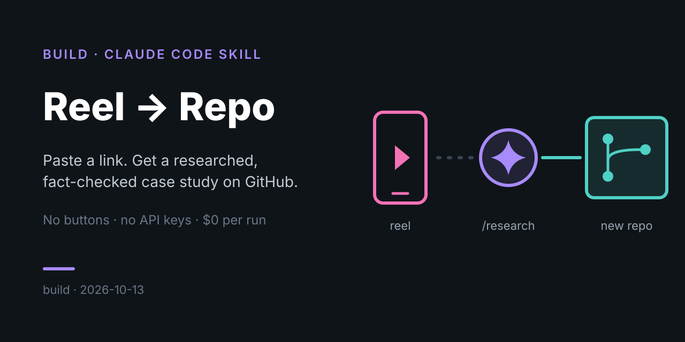
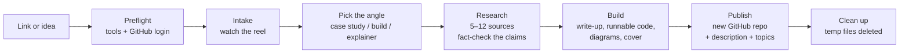
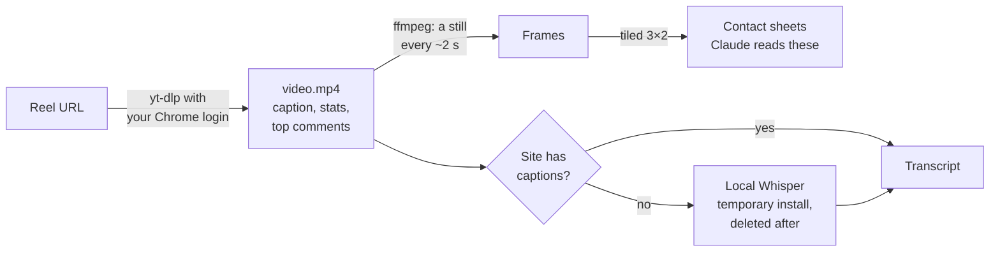

# Reel → Repo: a Claude Code skill that turns a link into a published case study

> **TL;DR:** I paste a reel link (or an article, or a one-line idea) and type `/research`. A [Claude Code](https://claude.com/claude-code) skill watches the reel, fact-checks it, researches it, writes and runs code, draws diagrams and a cover, then publishes the result as its own GitHub repo. No buttons, no API keys, $0 per run.

**Angle:** build · **Date:** 2026-10-13 · **Stack:** Claude Code skill + Python standard library + yt-dlp + ffmpeg + local Whisper + GitHub CLI

## Demo

**Input** (the whole thing):

```
/research https://www.instagram.com/reel/DeaqJsDRe29/
```

A one-minute reel pitching "rentable solar cold rooms for farmers in India."

**Output:** [**india-cold-chain-case-study**](https://github.com/maxsancheez/india-cold-chain-case-study), a new public repo containing:

| What | Details |
|---|---|
| Claim vs. reality table | 6 claims from the reel checked against sources. It caught an on-screen "40–50% of crops lost" stat that measured data puts at 5–15% per crop, and cleared up a commenter's confusion about a "40%" figure |
| 2 diagrams | Where produce gets stuck in India's cold chain, and how money moves in a pay-per-crate cold room |
| Working code | A unit-economics model with real output. Finding: at ~INR 5/crate/day the room never pays back; it needs ~INR 8.8 |
| 16 sources | Government data, industry reports, company coverage |
| Cover graphic | Hand-drawn SVG, no image API |

## How it works



The skill is one instruction file ([`SKILL.md`](skill/research/SKILL.md)) that tells Claude the process, plus small Python scripts for the mechanical parts. Claude does the judgment work: what the reel is really claiming, which angle fits, what to research, what code is worth writing.

### How it "watches" a reel

Claude can't play video or hear audio, but it can read images. So the skill turns the reel into things Claude can read:



Reading the contact sheets is how it picked up the on-screen loss table, the cold-storage stats, the company logos and the consultancy quote in the demo reel. None of that was in the caption.

| Script | Job |
|---|---|
| [`preflight.py`](skill/research/scripts/preflight.py) | Checks GitHub login, yt-dlp, ffmpeg and transcription settings |
| [`fetch_reel.py`](skill/research/scripts/fetch_reel.py) | Downloads the reel through your Chrome login; pulls caption, stats, top comments and platform captions; extracts frames and contact sheets |
| [`transcribe_local.py`](skill/research/scripts/transcribe_local.py) | Builds a throwaway Python environment, runs Whisper on your Mac, then deletes everything, even on failure |
| [`publish.py`](skill/research/scripts/publish.py) | Creates the repo (or updates one it made before), sets description and topics, pushes. Never overwrites a repo you made by hand |
| [`setup.sh`](skill/research/setup.sh) | One-time install of gh, yt-dlp and ffmpeg (~125 MB), plus GitHub login |

## How it got built

This was built in one conversation with Claude Code, and most of the design came from pushing back on the first version:

| Decision | First version | What changed | Why |
|---|---|---|---|
| Cover image | OpenAI image API | Claude draws an SVG | GitHub's social preview is one image per repo and can't be set by API, so an API key wasn't worth it |
| Getting the reel | Logged-out download | Uses your Chrome login | Instagram blocks logged-out requests; you're already logged in |
| "Seeing" the reel | Caption + page text only | Frames + contact sheets | Claude can read images. Most reels put their key points on screen |
| Voiceover | OpenAI transcription | Local Whisper, self-deleting | No key, nothing kept. Measured: 262 MB env + 141 MB model, about 3 min, **0 bytes left after** |
| Hands-free | Permission prompt per command | Skill pre-approves its own tools | The goal was "paste a link, walk away" |
| Where it publishes | One `research-lab` repo with entries in subfolders | One standalone repo per study | Match the rest of my GitHub (`china-equities-case-study`, `colombia-dynasty-wealth`) |
| Diagrams | Top-to-bottom, pastel fills | Left-to-right, explicit text color | GitHub previews diagrams in a short box, and light text vanished in dark mode |

Bugs found on the first real run, all fixed:
- **Missing duration:** Instagram didn't report the video length, so the frame count blew past its cap. It now reads the length from the file.
- **Subtitles blocking the video:** a failed download of a translated subtitle cancelled the video download. Captions are now fetched separately and can't block the video.
- **Login invisible in the app:** the terminal inside the Claude app can't see the GitHub login in the macOS keychain, so setup asked to log in again. That's harmless; the agent itself can see it.

## Install it

Needs macOS, [Claude Code](https://claude.com/claude-code) and a GitHub account.

```bash
git clone https://github.com/maxsancheez/reel-to-repo.git
cp -R reel-to-repo/skill/research ~/.claude/skills/
~/.claude/skills/research/setup.sh
```

Then, in a new Claude Code session:

```
/research <reel link | article URL | idea>
```

Settings live in `~/.config/research-drop/env`: public or private repos, where local copies go, transcription on/off, and Whisper model size. `SKILL.md` mentions my repos as naming examples; swap in your own.

## Costs and footprint
- **Money:** $0 per run. No API keys.
- **Permanent disk:** about 125 MB (gh, yt-dlp, ffmpeg in `~/.local/bin`).
- **Per run:** about 400 MB of temporary files (video, frames, the Whisper install), all deleted at the end.
- **Time:** about 10 minutes per reel. Transcription takes about 3 of those and runs in the background while research happens.

## Limits and safety
- **Content is treated as data.** Captions, transcripts, comments and web pages can't give the agent instructions; it's told to ignore any it finds.
- **Pre-approved Python.** While a run is going, the skill can run Python without asking, because it has to run the code it writes. That's the price of hands-free.
- **Copyright.** The reel's video, frames and transcript are never published. Write-ups summarize in their own words, with at most one short quote.
- **Transcription accuracy:** the `base` Whisper model is good but not perfect; it heard "trunks" as "punks" in a test. `WHISPER_MODEL=small` is more accurate.
- **Instagram** can still block downloads. The skill then falls back to the page text and search.
- **Social preview images** still have to be uploaded by hand in each repo's settings, if you want them.

## Repo layout

```
reel-to-repo/
  README.md               ← this write-up
  cover.svg
  skill/research/         ← copy this folder to ~/.claude/skills/
    SKILL.md              ← the instructions Claude follows
    setup.sh              ← one-time install + GitHub login
    scripts/
      preflight.py
      fetch_reel.py
      transcribe_local.py
      publish.py
      _config.py
```

## Sources
1. [Claude Code skills documentation](https://docs.claude.com/en/docs/claude-code/skills): how skills, slash commands and `allowed-tools` work
2. [yt-dlp](https://github.com/yt-dlp/yt-dlp): video and metadata download, `--cookies-from-browser`
3. [faster-whisper](https://github.com/SYSTRAN/faster-whisper): local speech-to-text used for transcripts
4. [imageio-ffmpeg](https://github.com/imageio/imageio-ffmpeg): source of the ffmpeg binary
5. [GitHub CLI](https://cli.github.com/): repo creation and publishing
6. [GitHub: Creating Mermaid diagrams](https://docs.github.com/en/get-started/writing-on-github/working-with-advanced-formatting/creating-diagrams): how GitHub renders the diagrams
